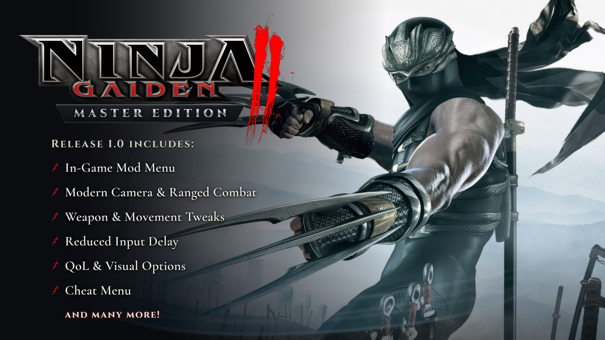

# NINJA GAIDEN II — Master Edition

Mod-menu with bunch of features for the original **Ninja Gaiden II** on the **Xenia Edge** emulator.

## What you get

- **In-Game Mod Menu** — MASTER OPTIONS, with a bunch of toggles that work right in the game!
- **Modern Camera** — a reworked, free and more comfortable camera, backported from the modern versions of
  Ninja Gaiden II.
- **Modern Ranged Combat** — Sigma 2 ranged weapon controls, even for Gatling Speargun. Now shuriken is ALWAYS B!
- **Weapon & Movement Tweaks**
  - **Sigma Framedata Backport** — small frame data tweaks from the modern versions of the game, mostly
    smoother and more responsive transitions between Ryu's moves.
  - **Weapon Property Fixes** — a port of Fiend Busa's mod for more precise tracking on several weapons.
- **Quality of Life** — skip the death screen, skip cutscenes, reduced input delay, consistent 60 fps
  cutscenes, a HUD that fades out when you're not fighting, and more!
- **Visual Options** — less bloom, no blur effects, MORE BLOOD AND GORE!
- **21:9 Ultrawide Support** — in Xenia's patch list!
- **Cheat Menu** — all weapons, infinite HP and ninpo, including Freeze Enemies!

## What you need

- Your own copy of **Ninja Gaiden II** with **Title Update 3** installed in Xenia.
- **Xenia Edge**.

## How to install

1. Download `master-edition.zip` from the [latest release](../../releases/latest) and open it. Inside is a folder called `xenia`.
2. Copy everything from that `xenia` folder into **Xenia's own folder** (see the table below). If you're asked
   about folders that already exist, agree to merge them.
3. In Xenia's settings, turn on plugins (`allow_plugins = true`).
4. Start the game. You'll find **MASTER OPTIONS** in the title menu, and in the pause menu.

If you already use other patches or plugins for Ninja Gaiden II, make a copy of them first. **Don't mix this mod
with older Ninja Gaiden II patch files!**

### Where is Xenia's own folder?

It depends on your system and on whether your Xenia is *portable* (has a `portable.txt` file next to the
Xenia program).

| System | Normal Xenia | Portable Xenia |
|---|---|---|
| Windows | `Documents\Xenia` | the folder with `xenia_edge.exe` |
| Linux | `~/.local/share/Xenia` | the folder with the Xenia program |
| macOS | `~/.local/share/Xenia` | the folder with the Xenia program |

- On Linux and macOS, `.local` is a hidden folder. To see it: in most Linux file managers press **Ctrl+H**;
  in macOS Finder press **Cmd+Shift+.** (period).
- On Linux, if you set `XDG_DATA_HOME` yourself, the folder is `$XDG_DATA_HOME/Xenia` instead.

## Menu options

Everything starts **Off**, so the game plays exactly like the original until you turn something on.

### Gameplay
- **Modern Ranged Combat** — the shuriken is always on B and gone from the inventory, ranged weapons fire with
  RT; aim the bow and the Gatling Speargun with LT and the right stick, move and shoot while aiming the bow.
- **Sigma Reticle** — the Sigma aiming reticle for the bow and the Gatling Speargun.
- **Block on LB** — swaps LT and LB.
- **Infinite Ammo** — arrows and shuriken never run out, the ammo counter is hidden.
- **Sigma Framedata Backport** — move timing from Sigma 2 and Black: dash into run, water moves, landing transitions. Not affecting gameplay in general, but make controls much responsive. 
- **Weapon Property Fixes** — ported from Fiend Busa's
  [Weapon Property Fixes](https://www.nexusmods.com/ninjagaiden2black/mods/100) for Ninja Gaiden 2 Black.
  Only the changes that apply to the original game and differ from it are included: tracking on Flail
  Forward Y, Lunar 360 UT, Dual Sword Forward Y, Tonfa Flying Swallow and Flail running X.
- **Lunar XY Launcher** — Lunar XY launches enemies, like in Sigma.
- **IS Single Shuriken** — IS ninjas throw one Incendiary Shuriken.
- **IS Visibility** — less intense Incendiary Shuriken explosions.
- **IS Fuse** — the IS ninjas' Incendiary Shuriken stick into walls and explode after a moment, like in the 2008
  prototype.
- **Ryu Fuse** — the same for Ryu's Incendiary Shuriken.

### Camera
- **Modern Camera** — a free and more comfortable camera, ported from the modern versions of Ninja Gaiden II.
  Applies when you load a save.
- **OT/UT Free Camera** — keep camera control during Obliteration Techniques, Ultimate Techniques, throws and
  more.
- **No Screen Shake** — no shake on hits, finishers and explosions.

### QoL
- **Skip Death Screen** — skips the GAME OVER screen.
- **Auto Chapter Screen** — chapter title cards and mission briefings continue without a button press.
- **First Time Cutscene Skip** — you can skip any cutscene, even the first time you see it.
- **Auto-Skip All Cutscenes** — every cutscene and movie is skipped automatically.
- **HUD** — show the HUD, let it fade out when you're not fighting, or hide it.
- **Hide Combat Counters** — hides the hit counter, karma and boss health; health, ninpo and ammo stay.
  A test feature for further experiments with HUD options.
- **Reduced Input Delay** — the game normally keeps up to two finished frames waiting before it shows them, and
  that waiting is the delay you feel.
  - **-1** lets only one frame wait: about one frame less delay (three frames become two).
  - **Max** lets no frames wait: the lowest delay. The game then waits for your graphics card every frame,
    so it needs a performance headroom, or it may stutter.
- **60 FPS Cutscenes** — cutscenes run at a steady 60 fps.
- **All Difficulties Unlocked** — Mentor and Master Ninja are available for a New Game.

### Visual
- **More Blood** — twice as much blood stays on floors and walls.
- **More Blood Particles** — bigger blood spray on every hit and delimb.
- **Reduce Bloom** — bloom at half strength, less overexposure.
- **No Post-Effects** — no blur, no white flashes.

### Cheats
- **Infinite HP** — Ryu's health keeps refilling.
- **Infinite Ninpo** — use ninpo without using it up.
- **Freeze Enemies** — enemies stand still.
- **All Weapons and Ninpo** — every weapon and ninpo from the start, at Lv1 or Lv3.
- **All Crystal Skulls** — all 30 crystal skulls count as collected.
- **Max HP and Ninpo** — full health and ninpo upgrades from the start.

Cheats that give items or upgrades stay in your save if you save the game at a statue.

## Good to know

- Most options work right away. **Modern Ranged Combat** and **Modern Camera** kick in the next time you load a
  save. If you change them during play, the menu reminds you with "Reload required".
- **1280x720** is on by default: the game renders at 1280x720 instead of its native 1120x584.
- **Widescreen 21:9** is in the same patch file, switched off. For a 3440x1440 picture, also set Xenia's
  resolution scale to 2.
- **To start the game again, close Xenia completely and open it again** — for example after you change something in
  Xenia's patch list. If you stop the game and start it again in the same Xenia window loading a save can crash. **This is a bug in Xenia's plugin system, not in the mod!**

## Credits

alicenotmech — mod author. 1280x720 Resolution patch by Margen67.
Weapon Property Fixes ported from the Ninja Gaiden 2 Black mod by Fiend Busa.
Ninja Gaiden II © KOEI TECMO GAMES / Team NINJA. This is an unofficial fan project.
