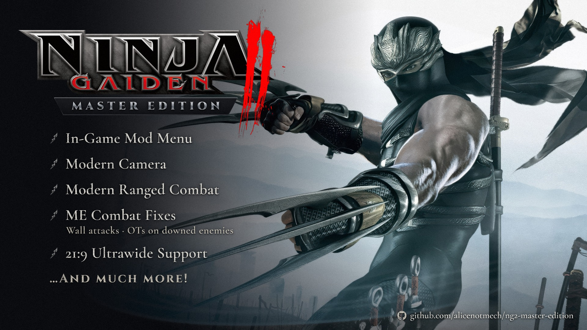
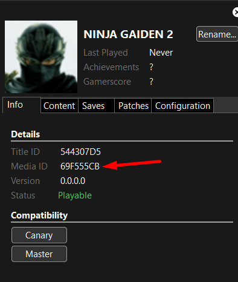
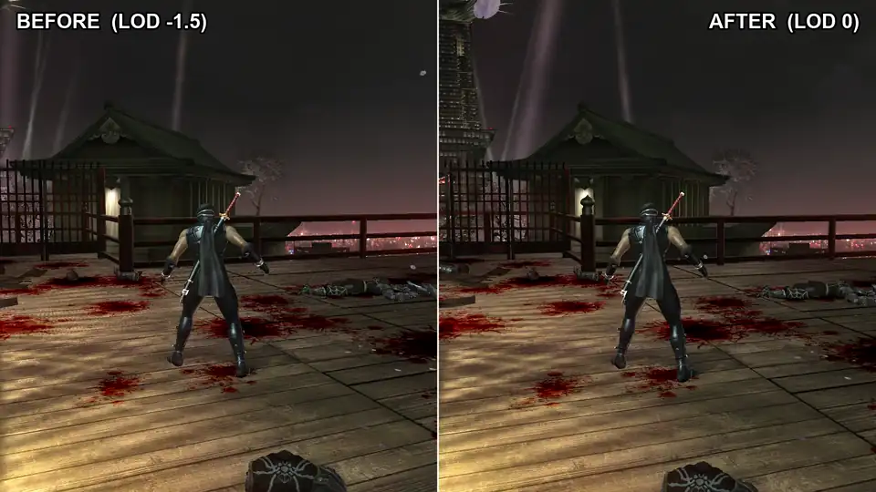
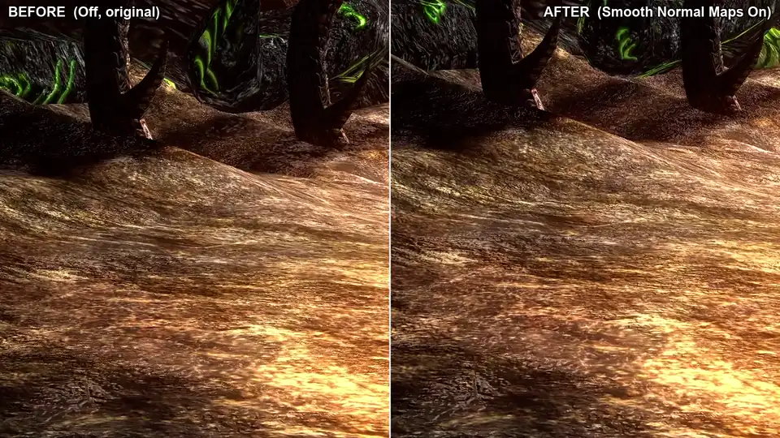
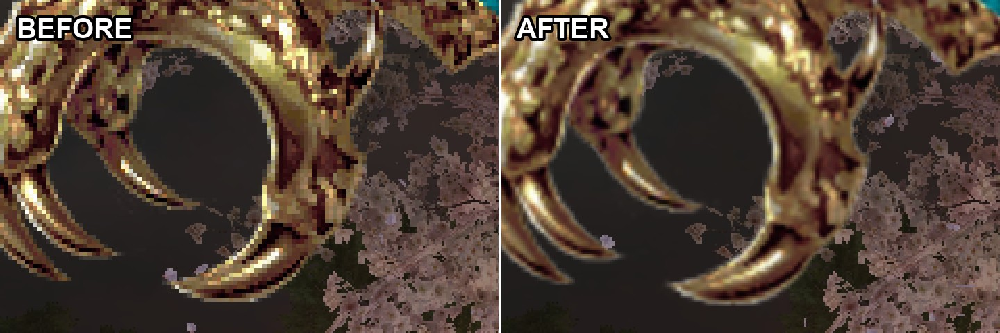
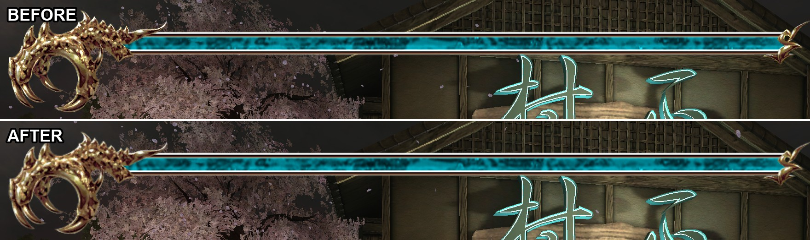
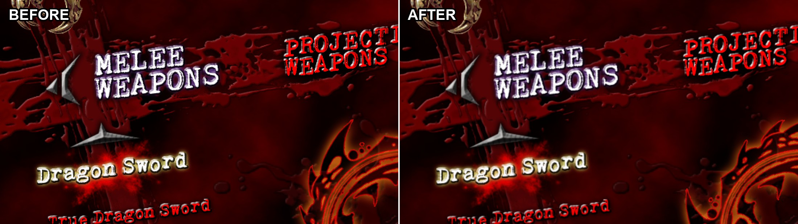
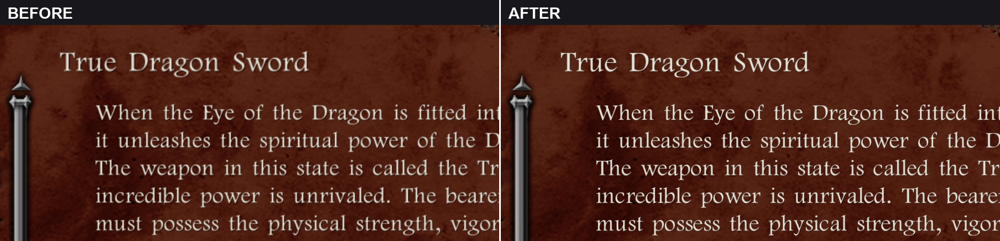
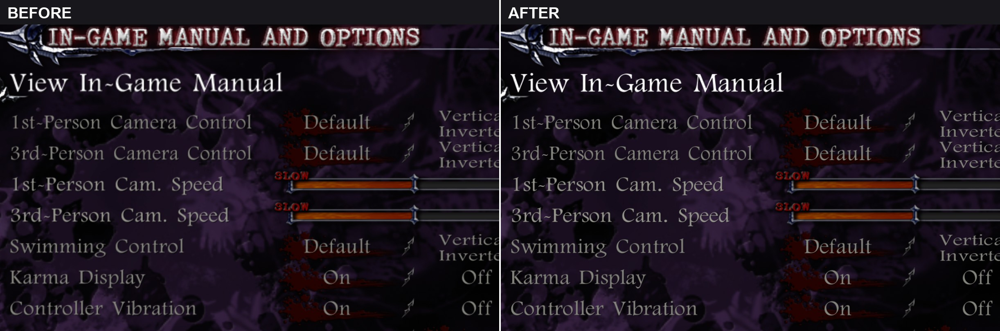

# Ninja Gaiden II Master Edition

> [!TIP]
> **1.1.1 Update is live!**
> - Improved Reduced Input Delay
> - Wall attack aiming in ME Combat Fixes
> - 2x MSAA fixes
> - Various bugfixes

An enhancement mod with a bunch of features for the original **Ninja Gaiden II** on the **Xenia Edge** emulator.

## What you get

- **In-Game Mod Menu**: MASTER OPTIONS, with a bunch of toggles that work right in the game
- **Modern Camera**: reworked and comfortable camera, backported from the modern versions of
  Ninja Gaiden II
- **Modern Ranged Combat**: Sigma ranged weapon controls, even for Gatling Speargun. Now shuriken is ALWAYS B!
- **Weapon & Movement Tweaks**
  - **ME Combat Fixes**: fixes for combat flaws of the original game: wall attacks, OTs on enemies on the ground,
    aiming of several moves, and enemies that react wrongly to some combos
- **Quality of Life**: skip the death screen, skip cutscenes, reduced input delay, consistent 60 fps
  cutscenes, a HUD that fades out when you're not fighting, and more
- **Visual Options**: less bloom, no blur effects, MORE BLOOD AND GORE!
- **21:9 Ultrawide Support**: in Xenia's patch list
- **Cheat Menu**: all weapons, infinite HP and ninpo, including Freeze Enemies

## What you need

- [Xenia Edge](https://github.com/has207/xenia-edge)
- Your own copy of **Ninja Gaiden II (World)** release with **Media ID 69F555CB**, or the **Japanese** release with
  **Media ID 0E6FB1CE**. Xenia shows the Media ID in the `Info` tab

  

- **Title Update 3** for your release, installed in Xenia. See [Title Update notes](#title-update-notes) for the
  exact files

## How to install

1. Back up any existing Ninja Gaiden II `.patch.toml` files from the `patches` folder. Keep the backup outside that folder.
2. Download `master-edition.zip` from the [latest release](../../releases/latest) and extract it
3. Copy the `patches` and `plugins` folders into:
   - Windows: `Documents\Xenia`
   - Windows with `portable.txt`: directly into the folder with `xenia_edge.exe`
   - macOS: `~/.local/share/Xenia` (hidden folder, press **Cmd+Shift+.** in Finder)
   - Linux: `~/.local/share/Xenia`
4. In Xenia's settings, turn on plugins: `Configuration > General > allow_plugins` or in config `allow_plugins = true`
5. **Title Update #3 must be the only title update in Xenia.** Delete any other one, or Xenia may load it instead and
   the mod will not start

   

6. Start the game. You'll find **MASTER OPTIONS** in the title menu, and in the pause menu

Xenia Edge builds for Linux and macOS are still unstable. Stability is not guaranteed, and issues on these
platforms may come from the emulator rather than the mod.

If you already use other patches or plugins for Ninja Gaiden II, make a copy of them first. **Don't mix this mod
with other Ninja Gaiden II patch files!**

## Menu options

All menu options start **Off**.

### Gameplay
- **ME Combat Fixes**. Fixes for combat flaws of the original game. Attacks while touching a wall or jumping off
  it aim at the enemy and connect, OTs on enemies lying on the ground connect, and several moves aim at enemies more
  reliably. With Dragon's Claw and Tiger's Fang, the Y, Y, Forward+Y launcher now lifts Gaja properly, and its
  second Y no longer launches dogs. Applies when you load a save
  - Wall attacks with the Dragon Sword, Vigoorian Flail, Lunar staff and Falcon's Talons: X off a wall with the
    stick held goes where the stick points (the original game picked the target on the mirrored side)
  - Falcon's Talons remember the stick direction during the wall attack wind-up
  - With the stick released, wall attacks pick the enemy in front of you as you leave the wall, and closer enemies
    win over far ones
- **Modern Ranged Combat**. The shuriken is always on B and gone from the inventory, ranged weapons fire with RT.
  Aim the bow and the Gatling Speargun with LB and the right stick, move and shoot while aiming the bow. Ninpo can
  be aimed with the right stick too. Holding RT charges the bow's Ultimate Technique. The game's
  **1st-Person Cam. Speed** and **1st-Person Camera Control** settings also apply to the LB aim camera

  **Controls:**

  | Button | Action |
  |---|---|
  | B | Shuriken (always; it is no longer in the inventory) |
  | RT | Fire the equipped ranged weapon |
  | Hold RT | Charge the bow's Ultimate Technique |
  | LB (hold) | Aim the bow or the Gatling Speargun; aim with the right stick, move with the left stick |
  | LT | Block |
  | Right stick | Aim ninpo while you cast it (cast as in the original game) |

  **Block on LB** swaps them: block on LB, aim on LT. Everything else is as in the original game.
- **Sigma Reticle**. The Sigma aiming reticle for the bow and the Gatling Speargun
- **Block on LB**. Swaps LT and LB
- **Infinite Ammo**. Arrows and shuriken never run out, the ammo counter is hidden
- **Lunar XY Launcher**. Lunar XY launches enemies, like in Sigma
- **IS Single Shuriken**. IS ninjas throw one Incendiary Shuriken
- **IS Visibility**. Less intense Incendiary Shuriken explosions
- **IS Fuse**. The IS ninjas' Incendiary Shuriken stick into walls and explode after a short delay, like in the 2008
  prototype
- **Ryu Fuse**. The same for Ryu's Incendiary Shuriken

### Camera
- **Modern Camera**. A free and more comfortable camera, ported from the modern versions of Ninja Gaiden II.
  The game's camera speed sliders work with it. Applies when you load a save
- **OT/UT Free Camera**. Keep camera control during OT, UT, throws etc.
- **No Screen Shake**. No shake on hits, finishers and explosions

### QoL
- **Skip Death Screen**. Skips the GAME OVER screen
- **Auto Chapter Screen**. Chapter title cards and mission briefings continue without a button press
- **First Time Cutscene Skip**. You can skip any cutscene, even the first time you see it
- **HUD**. Show the HUD, let it fade out when you're not fighting, or hide it
- **Hide Combat Counters**. Hides the hit counter, karma and boss health, while health, ninpo and ammo stay.
  A test feature for further experiments with HUD options
- **Reduced Input Delay**. One frame less delay. Finished frames go to the screen at once instead of waiting in a
  queue, and the game times each frame to the screen refresh, so frames still come at an even pace. Needs Xenia's
  `framerate_limit = 0` and no FPS cap in RTSS or the graphics driver
  - **On** works on most PCs
  - **Max** shows each frame a little sooner, but needs some performance headroom, or frames may come unevenly
- **60 FPS Cutscenes**. Cutscenes run at a steady 60 fps
- **All Difficulties Unlocked**. Mentor and Master Ninja are available for a New Game

### Visual
- **More Blood**. Twice as much blood stays on floors and walls
- **More Blood Particles**. Bigger blood spray on every hit and delimb
- **Reduce Bloom**. Bloom at half strength, less overexposure
- **No Post-Effects**. No blur, no white flashes
- **Texture LOD Bias**. 0 removes the floor and texture shimmer at Xenia scale 2x (default). -1.0 is the Sigma 2
  value, -1.5 the original

  
- **Smooth Normal Maps**. Trilinear filtering for normal maps: no moving bands on surfaces, softer highlights.
  Works best with Texture LOD Bias 0. Off keeps the original look. On by default

  
- **Hi-res Shadows**. Always the 1024 shadow map; the original drops to 512 in combat
- **Skip 4x MSAA Clear**. 10-15% less GPU load, same picture. On by default
- **Hide Ranged on Back**. The bow and the Gatling Speargun are not shown on Ryu's back. In his hands they look as
  usual. Co-created with [MegidoKira](https://github.com/MegidoKira)
- **Weapon Appearance**. A submenu: choose how each melee weapon looks (Lv1, Lv2 or Lv3), or one look for all of
  them with **All Weapons**
- **Smooth HUD and Menus**. HUD and menu sprites are smoothed: no more pixel steps at Xenia scale 2x

### Cheats
- **Infinite HP**. Ryu takes no damage
- **Infinite Ninpo**
- **Freeze Enemies**. Enemies stand still
- **One-Hit Kill**. Any hit kills an enemy
- **Instant Charge**. Charge attacks reach ET and UT at once
- **Rich Essence**. Each yellow essence pickup gives 10,000
- **All Weapons and Ninpo**. Every weapon and ninpo from the start, at Lv1 or Lv3
- **All Crystal Skulls**. All 30 crystal skulls count as collected
- **Max HP and Ninpo**. Full health and ninpo upgrades from the start

Cheats that give items or upgrades stay in your save if you save the game at a statue

## Good to know

- Most options work right away. **Modern Ranged Combat** and **Modern Camera** kick in the next time you load a
  save. If you change them during play, the menu reminds you with "Reload required"
- **1280x720** is on by default: the game renders at 1280x720 instead of its native 1120x584
- **Widescreen 21:9**: For a 3440x1440 picture, also set Xenia's resolution scale to 2
- **Hi-Res Font** (off by default): sharp UI text at Xenia scale 2x. Applies after restarting the game

  

  
- **Experimental: Native 2x MSAA** (off by default, 16:9 only): smoother edges, higher GPU load (about a quarter
  more; heavy scenes like Ultimate Techniques in big crowds may drop frames on a weaker GPU). Don't use it together
  with Widescreen 21:9

## Title Update notes

| Release | Media ID | Title Update in Xenia | File | Size | SHA-256 |
|---|---|---|---|---|---|
| World | `69F555CB` | Ninja Gaiden 2 Title Update #3 | `TU_1A461UL_000000G000000.00000000000O4` | 2,486,272 bytes | `93efbdda961d4b75d3c1a68083f85b61c1758e1136dfa4a581a9196620502aeb` |
| Japanese | `0E6FB1CE` | Ninja Gaiden 2 (Re-sign) Title Update #3 | `TU_1A461UL_000000C000000.00000000000O3` | 2,486,272 bytes | `1adc81d4c0de67a9489ea2164e42617759f697f64461b51fbd6ec01ed6e72a06` |

With the right title update, `xenia.log` contains the line `Module Hash: 4CC4201C0C4ED58B` after the game starts.
If that line is missing, the mod will not load

- **Only one title update.** With Title Update #2 and #3 installed at the same time, Xenia can load #2, and the mod
  does not start. Keep only #3
- **Matching title update.** Both releases run the same game code, so the mod works with either TU3. Use the one
  for your release: the Japanese TU3 on the World release also works, but Xenia warns about a hash mismatch

## Known Issues

- **Xenia restart crash**. Restarting the game in the same Xenia window can cause a crash when loading a save
  **Close Xenia completely before starting again.** This is a bug in Xenia's plugin system, not in the mod
- **60 FPS Cutscenes**. In my experience, audio seems to gradually go out of sync in some cutscenes
  This still needs more testing and research

## License

**Permission required.** Free to use with your own copy of the game.

Working on a port, a recompilation or another mod? I know the mod's code is out there and can be taken apart.
Still, please ask me on [Discord](https://discord.com/users/371353069201653773) before you port my features to your project or re-upload
the mod: that way I know where my work is used, and I can help you port my own features properly.

Versions before 1.1.1 stay under the MIT License. Full text: LICENSE.txt

## Credits

Mod by alicenotmech  
1280x720 Resolution patch by Margen67.  
Hide Ranged on Back co-created with [MegidoKira](https://github.com/MegidoKira).  
Instant Charge and Rich Essence are based on Xenia patches by bader0418.  
Thanks to Fiend Busa for the Ninja Gaiden 2 Black mod Weapon Property Fixes, ported in 1.0.x.  
Thanks to the testers: griever666, DarkMelody, Wedcone, Arzo, Hinzoto and GiladN.  
Ninja Gaiden II © KOEI TECMO GAMES / Team NINJA. This is an unofficial fan project.
