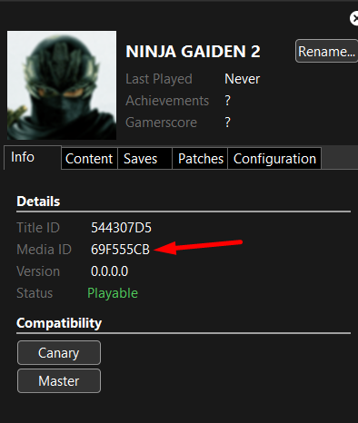
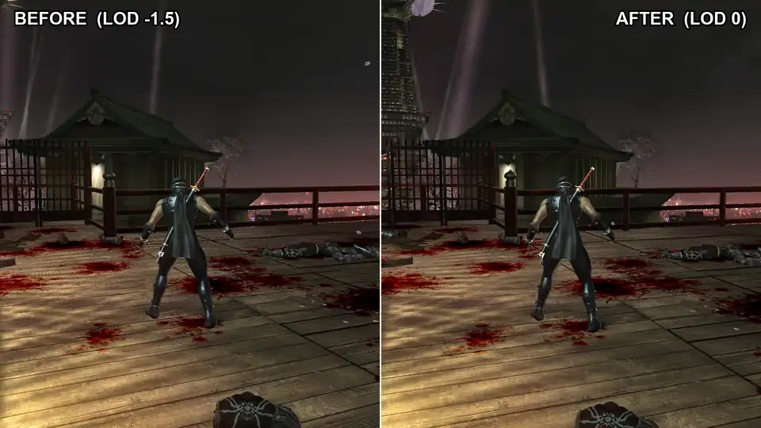
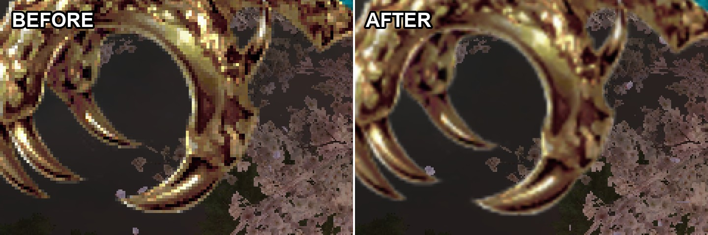
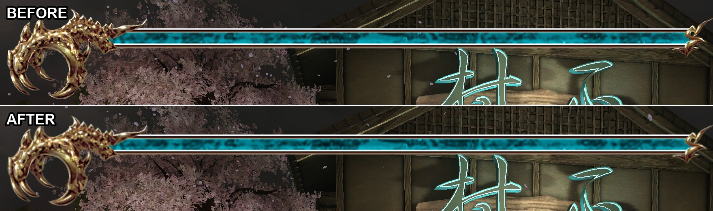
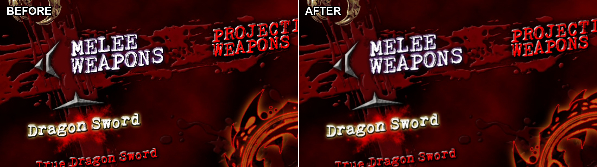

# Ninja Gaiden II Master Edition

> ### 1.0.2 Visual Update is live!
> - No more floor and texture shimmer at Xenia scale 2x
> - Smooth HUD and menus: no more pixel steps
> - Sharp shadows in combat too
> - 10-15% less GPU load with the same picture
> - Optional sharp UI text and experimental 2x MSAA

An enhancement mod with a bunch of features for the original **Ninja Gaiden II** on the **Xenia Edge** emulator.

## What you get

- **In-Game Mod Menu**: MASTER OPTIONS, with a bunch of toggles that work right in the game
- **Modern Camera**: reworked and comfortable camera, backported from the modern versions of
  Ninja Gaiden II
- **Modern Ranged Combat**: Sigma ranged weapon controls, even for Gatling Speargun. Now shuriken is ALWAYS B!
- **Weapon & Movement Tweaks**
  - **Sigma Framedata Backport**: small frame data tweaks from the modern versions of the game, mostly
    smoother and more responsive transitions between Ryu's moves
  - **Weapon Property Fixes**: a port of Fiend Busa's mod for more precise tracking on several weapons
- **Quality of Life**: skip the death screen, skip cutscenes, reduced input delay, consistent 60 fps
  cutscenes, a HUD that fades out when you're not fighting, and more
- **Visual Options**: less bloom, no blur effects, MORE BLOOD AND GORE!
- **21:9 Ultrawide Support**: in Xenia's patch list
- **Cheat Menu**: all weapons, infinite HP and ninpo, including Freeze Enemies

## What you need

- [Xenia Edge](https://github.com/has207/xenia-edge)
- Your own copy of **Ninja Gaiden II (World)** release with **Media ID 69F555CB**, or the **Japanese** release with
  **Media ID 0E6FB1CE**. Xenia shows the Media ID in the `Info` tab

  

- **Title Update 3** for your release, installed in Xenia. See [Title Update notes](#title-update-notes) for the
  exact files

## How to install

1. Back up any existing Ninja Gaiden II `.patch.toml` files from the `patches` folder. Keep the backup outside that folder.
2. Download `master-edition.zip` from the [latest release](../../releases/latest) and extract it
3. Copy the `patches` and `plugins` folders into:
   - Windows: `Documents\Xenia`
   - Windows with `portable.txt`: directly into the folder with `xenia_edge.exe`
   - macOS: `~/.local/share/Xenia` (hidden folder, press **Cmd+Shift+.** in Finder)
   - Linux: `~/.local/share/Xenia`
4. In Xenia's settings, turn on plugins: `Configuration > General > allow_plugins` or in config `allow_plugins = true`
5. **Title Update #3 must be the only title update in Xenia.** Delete any other one, or Xenia may load it instead and
   the mod will not start

   

6. Start the game. You'll find **MASTER OPTIONS** in the title menu, and in the pause menu

Xenia Edge builds for Linux and macOS are still unstable. Stability is not guaranteed, and issues on these
platforms may come from the emulator rather than the mod.

If you already use other patches or plugins for Ninja Gaiden II, make a copy of them first. **Don't mix this mod
with other Ninja Gaiden II patch files!**

## Menu options

All menu options start **Off**.

### Gameplay
- **Modern Ranged Combat** — the shuriken is always on B and gone from the inventory, ranged weapons fire with
  RT. Aim the bow and the Gatling Speargun with LT and the right stick, move and shoot while aiming the bow
- **Sigma Reticle** — the Sigma aiming reticle for the bow and the Gatling Speargun
- **Block on LB** — swaps LT and LB
- **Infinite Ammo** — arrows and shuriken never run out, the ammo counter is hidden
- **Sigma Framedata Backport** — move timing from Sigma 2 and Black: dash into run, water moves, landing transitions.
  These tweaks keep the core gameplay intact but make the controls much more responsive
- **Weapon Property Fixes** — ported from Fiend Busa's
  [Weapon Property Fixes](https://www.nexusmods.com/ninjagaiden2black/mods/100) for Ninja Gaiden 2 Black
  Only the changes that apply to the original game and differ from it are included: tracking on Flail
  Forward Y, Lunar 360 UT, Dual Sword Forward Y, Tonfa Flying Swallow and Flail running X
- **Lunar XY Launcher** — Lunar XY launches enemies, like in Sigma
- **IS Single Shuriken** — IS ninjas throw one Incendiary Shuriken
- **IS Visibility** — less intense Incendiary Shuriken explosions
- **IS Fuse** — the IS ninjas' Incendiary Shuriken stick into walls and explode after a short delay, like in the 2008
  prototype
- **Ryu Fuse** — the same for Ryu's Incendiary Shuriken

### Camera
- **Modern Camera** — a free and more comfortable camera, ported from the modern versions of Ninja Gaiden II.
  Applies when you load a save
- **OT/UT Free Camera** — keep camera control during OT, UT, throws etc.
- **No Screen Shake** — no shake on hits, finishers and explosions

### QoL
- **Skip Death Screen** — skips the GAME OVER screen
- **Auto Chapter Screen** — chapter title cards and mission briefings continue without a button press
- **First Time Cutscene Skip** — you can skip any cutscene, even the first time you see it
- **HUD** — show the HUD, let it fade out when you're not fighting, or hide it
- **Hide Combat Counters** — hides the hit counter, karma and boss health, while health, ninpo and ammo stay.
  A test feature for further experiments with HUD options
- **Reduced Input Delay** — the game normally keeps up to two finished frames waiting before it shows them, and
  that waiting is the delay you feel
  - **-1** lets only one frame wait: about one frame less delay (three frames become two)
  - **Max** lets no frames wait: the lowest delay. The game then waits for your graphics card every frame,
    so it needs some performance headroom, or it may stutter
- **60 FPS Cutscenes** — cutscenes run at a steady 60 fps
- **All Difficulties Unlocked** — Mentor and Master Ninja are available for a New Game

### Visual
- **More Blood** — twice as much blood stays on floors and walls
- **More Blood Particles** — bigger blood spray on every hit and delimb
- **Reduce Bloom** — bloom at half strength, less overexposure
- **No Post-Effects** — no blur, no white flashes
- **Texture LOD Bias** — 0 removes the floor and texture shimmer at Xenia scale 2x (default). -1.0 is the Sigma 2
  value, -1.5 the original

  

  [Full-quality video](images/lod_before_after.mp4)
- **Hi-res Shadows** — always the 1024 shadow map; the original drops to 512 in combat. On by default
- **Skip 4x MSAA Clear** — 10-15% less GPU load, same picture. On by default

HUD and menu sprites are always filtered: no more pixel steps at Xenia scale 2x

### Cheats
- **Infinite HP**
- **Infinite Ninpo**
- **Freeze Enemies** — enemies stand still
- **All Weapons and Ninpo** — every weapon and ninpo from the start, at Lv1 or Lv3
- **All Crystal Skulls** — all 30 crystal skulls count as collected
- **Max HP and Ninpo** — full health and ninpo upgrades from the start

Cheats that give items or upgrades stay in your save if you save the game at a statue

## Good to know

- Most options work right away. **Modern Ranged Combat** and **Modern Camera** kick in the next time you load a
  save. If you change them during play, the menu reminds you with "Reload required"
- **1280x720** is on by default: the game renders at 1280x720 instead of its native 1120x584
- **Widescreen 21:9**: For a 3440x1440 picture, also set Xenia's resolution scale to 2
- **Hi-Res Font** (off by default): sharp UI text at Xenia scale 2x. Applies after restarting the game
- **Experimental: Native 2x MSAA** (off by default, 16:9 only): smoother edges, higher GPU load. Don't use it together
  with Widescreen 21:9

## Title Update notes

| Release | Media ID | Title Update in Xenia | File | Size | SHA-256 |
|---|---|---|---|---|---|
| World | `69F555CB` | Ninja Gaiden 2 Title Update #3 | `TU_1A461UL_000000G000000.00000000000O4` | 2,486,272 bytes | `93efbdda961d4b75d3c1a68083f85b61c1758e1136dfa4a581a9196620502aeb` |
| Japanese | `0E6FB1CE` | Ninja Gaiden 2 (Re-sign) Title Update #3 | `TU_1A461UL_000000C000000.00000000000O3` | 2,486,272 bytes | `1adc81d4c0de67a9489ea2164e42617759f697f64461b51fbd6ec01ed6e72a06` |

With the right title update, `xenia.log` contains the line `Module Hash: 4CC4201C0C4ED58B` after the game starts.
If that line is missing, the mod will not load

- **Only one title update.** With Title Update #2 and #3 installed at the same time, Xenia can load #2, and the mod
  does not start. Keep only #3
- **Matching title update.** Both releases run the same game code, so the mod works with either TU3. Use the one
  for your release: the Japanese TU3 on the World release also works, but Xenia warns about a hash mismatch

## Known Issues

- **Xenia restart crash** — restarting the game in the same Xenia window can cause a crash when loading a save
  **Close Xenia completely before starting again.** This is a bug in Xenia's plugin system, not in the mod
- **60 FPS Cutscenes** — in my experience, audio seems to gradually go out of sync in some cutscenes
  This still needs more testing and research

## Credits

Mod by alicenotmech  
1280x720 Resolution patch by Margen67.  
Weapon Property Fixes ported from the Ninja Gaiden 2 Black mod by Fiend Busa.  
Ninja Gaiden II © KOEI TECMO GAMES / Team NINJA. This is an unofficial fan project.
